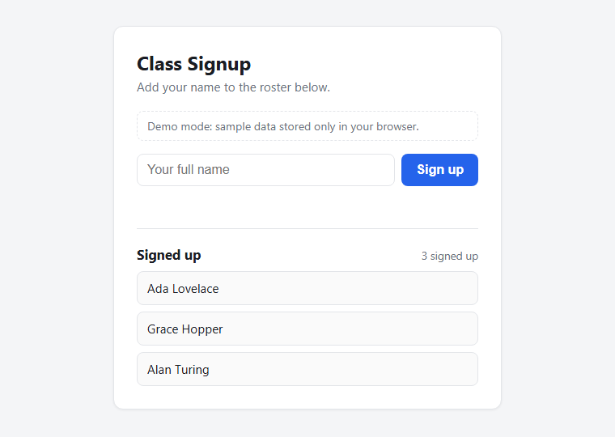

# Class Signup

A dependency-free single-page frontend for a class signup REST API. Students enter their name, and the roster updates live. The page handles every response the API can return: success, duplicate, validation error, server error and network failure.

**Live demo:** [vivekkhedkar-oss.github.io/class-signup](https://vivekkhedkar-oss.github.io/class-signup/) (runs in demo mode with sample data)



- **Stack:** HTML, CSS and vanilla JavaScript (`fetch`, `async`/`await`). No framework and no build step.
- **Size:** about 400 lines total across [`index.html`](index.html), [`app.js`](app.js) and [`styles.css`](styles.css)

## What it does

- **Loads the roster** with `GET /api/signups` and shows a count of who's signed up
- **Signs up** with `POST /api/signups`, then re-fetches so the list always matches the server
- **Maps each status code to a clear message:** `201` shows a success message and refreshes the list, `409` reports that the name is already signed up, and other errors show the API's own message (or a generic fallback if the body isn't JSON). A network failure gets its own message.
- **Avoids duplicate submissions** by disabling the button while a request is in flight
- **Supports accessibility:** labelled inputs and `aria-live` status regions, so screen readers announce loading, success and error states
- **Responsive design:** a single card layout that works from phone width up

## Demo mode

The real API is a shared class roster, so the public copy of this page shouldn't read or write it. In **demo mode**, `app.js` swaps `fetch` for a small in-browser mock that returns the same status codes and JSON shapes as the real API (`200`, `201`, `400`, `409`). The UI code path stays identical, and signups are saved only to your browser's `localStorage`.

Demo mode turns on automatically on GitHub Pages, or anywhere you add `?demo` to the URL.

## Run locally

```bash
python -m http.server 5173
```

Then open:

- <http://localhost:5173/?demo> to use sample data
- <http://localhost:5173/> to use the live class API
